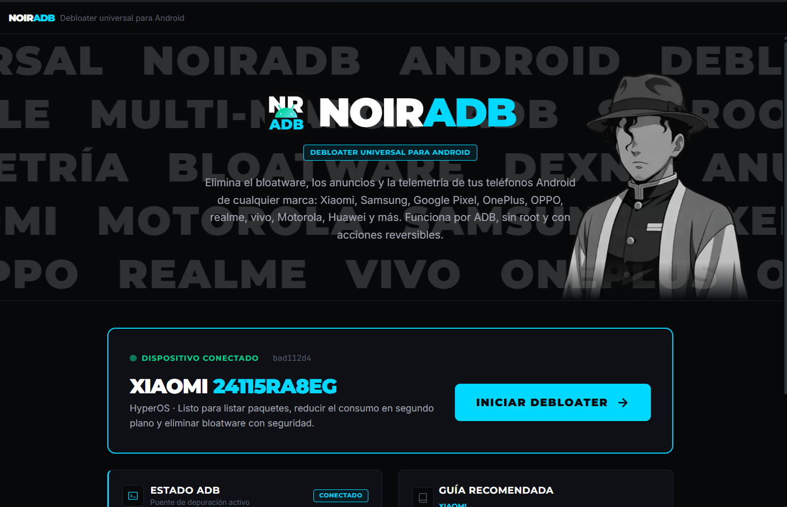
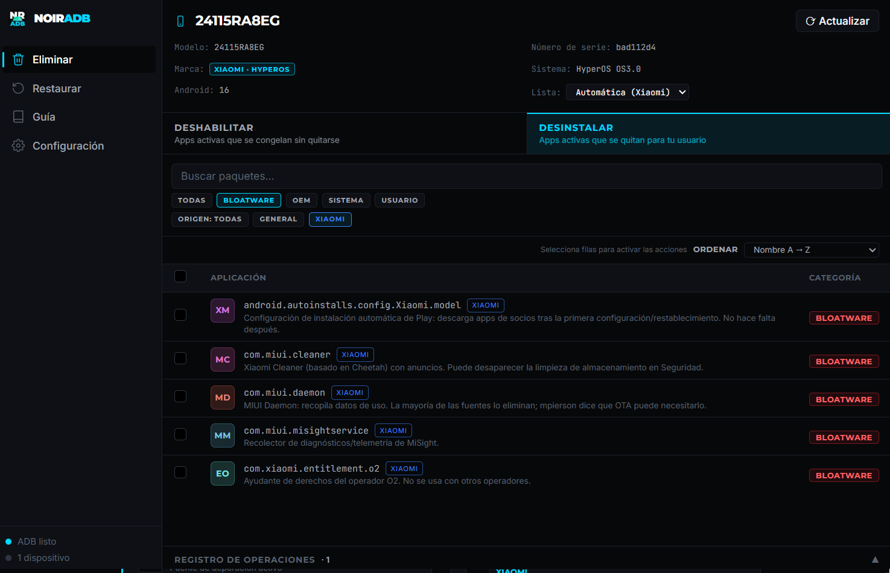

# Noir Android Debloater (NoirADB) — elimina el bloatware de tu Android sin root

**Noir Android Debloater** (**NoirADB**) es una aplicación de escritorio universal, gratuita y de código abierto para desinstalar bloatware, aplicaciones innecesarias, publicidad y servicios de telemetría en teléfonos Android de cualquier marca: **Xiaomi, Redmi, POCO, Samsung, Google Pixel, OnePlus, OPPO, realme, vivo/iQOO, Motorola, Huawei, Honor** y muchas más.

Funciona de forma directa mediante ADB, **sin necesidad de root, sin modificar particiones del sistema y sin desbloquear el bootloader**. Compatible con **Windows, macOS y Linux**, diseñada bajo la identidad visual *Flat Noir* (**DexNR**).

La base de datos se estructura en **una lista de paquetes por fabricante más una lista general** con el software basura compartido entre marcas. Cada paquete cuenta con descripciones detalladas en español y clasificación por nivel de riesgo, manteniéndose actualizadas en la nube sin requerir reinstalaciones continuas de la aplicación.

---

## Características

- **Soporte multi-marca universal:** Detección automática del fabricante y la capa de personalización (HyperOS, One UI, Pixel, OxygenOS, ColorOS, realme UI, Funtouch/OriginOS, Hello UX, EMUI/MagicOS, etc.) con asignación dinámica de la lista correspondiente.
- **Estructura modular (`general` + por marca):** El bloatware compartido (preinstalaciones comerciales de Facebook, Netflix, TikTok, Booking, Amazon y stubs de operadoras) se gestiona de forma centralizada, dejando las listas de fabricantes estrictamente enfocadas en su software nativo.
- **Filtro de origen:** Permite filtrar instantáneamente en la interfaz entre *Todas*, *General* o la marca detectada (*Xiaomi*, *Samsung*, etc.).
- **Completamente seguro y reversible:** Las aplicaciones se remueven únicamente para el usuario actual (`pm uninstall -k --user 0`). El archivo APK base se preserva intacto en el sistema y puede restaurarse en cualquier momento con un solo clic desde la sección **Restaurar**.
- **Acciones por lote y unitarias:** Deshabilita, desinstala, habilita y restaura individualmente o en selección múltiple tras confirmación.
- **Secciones Eliminar y Restaurar:** Las apps activas se gestionan en **Eliminar** (pestañas **Deshabilitar** y **Desinstalar**), mientras que las apps ya deshabilitadas o eliminadas se recuperan en **Restaurar** (pestañas **Deshabilitadas** y **Eliminadas**), sin mezclarse con las activas.
- **Filtros por categoría y origen:** Navegación por Bloatware, OEM, Sistema, Usuario y por origen (General o la marca detectada), o búsqueda por nombre de paquete.
- **Guía interactiva integrada:** Documentación exhaustiva paso a paso con recomendaciones generales de Android y apartados específicos por marca.
- **Selector manual de fabricante:** Posibilidad de alternar o forzar la marca manualmente ante dispositivos genéricos o no catalogados.
- **Registro de auditoría:** Historial en vivo con cada comando ADB ejecutado y su respuesta.

---

## Teléfonos compatibles

Cualquier dispositivo Android con depuración USB habilitada:

- **Xiaomi / Redmi / POCO:** MIUI 12, 13, 14 y HyperOS 1, 2 y 3 (ROMs Global, EEA, India y China).
- **Samsung:** One UI (Galaxy serie S, Z, A, M).
- **Google:** Dispositivos Pixel y derivados AOSP.
- **OnePlus:** OxygenOS y HydrogenOS.
- **OPPO:** ColorOS.
- **realme:** realme UI.
- **vivo / iQOO:** Funtouch OS y OriginOS.
- **Motorola:** Hello UX y My UX.
- **Huawei / Honor:** EMUI, MagicOS y HarmonyOS.
- **Otras marcas con listas integradas:** Asus (ROG / ZenUI), Sony (Xperia), Nokia / HMD (Evenwell), Lenovo (ZUI), ZTE (MyOS), TCL / Alcatel, nubia (RedMagic) y Meizu (Flyme).

---

## Cómo debloatear tu teléfono

1. **Instala ADB:**
   - **Windows:** `winget install Google.PlatformTools` (o descarga *platform-tools* oficial).
   - **macOS:** `brew install android-platform-tools`.
   - **Linux:** `sudo apt install adb` (o equivalente en tu distribución).
2. **Activa las opciones de desarrollador:**
   - Ve a *Ajustes > Acerca del teléfono* y pulsa entre 7 y 10 veces continuas sobre el **Número de compilación** (en Xiaomi, *Versión de MIUI* o *Versión del OS*).
3. **Activa la depuración por USB:**
   - Ve a *Ajustes > Sistema / Opciones de desarrollador* y habilita **Depuración por USB**.
4. **Conecta el teléfono a la PC:**
   - Mediante cable USB, acepta el diálogo de autorización con la huella digital RSA marcando *"Permitir siempre desde este ordenador"*.
5. **Inicia NoirADB:**
   - Tu dispositivo, modelo y paquetes instalados se cargarán automáticamente en pocos segundos.
6. **Elimina bloatware con confianza:**
   - Comienza por los paquetes de la categoría **Bloatware** marcados como `seguro`. Consulta la pestaña **Guía** antes de modificar paquetes marcados con `precaución` o `peligroso`.

---

## Descargas

Descarga directa de los ejecutables compilados para cada plataforma:

| Plataforma | Binario |
|---|---|
| **Windows x64** | [noiradb-windows-amd64.exe](https://github.com/NOIR-DexPrkr/android-debloater/releases/latest/download/noiradb-windows-amd64.exe) |
| **Windows ARM64** | [noiradb-windows-arm64.exe](https://github.com/NOIR-DexPrkr/android-debloater/releases/latest/download/noiradb-windows-arm64.exe) |
| **macOS (Universal Intel / Apple Silicon)** | [noiradb-macos-universal.zip](https://github.com/NOIR-DexPrkr/android-debloater/releases/latest/download/noiradb-macos-universal.zip) |
| **Linux (tar.gz)** | [x64](https://github.com/NOIR-DexPrkr/android-debloater/releases/latest/download/noiradb-linux-amd64.tar.gz) · [ARM64](https://github.com/NOIR-DexPrkr/android-debloater/releases/latest/download/noiradb-linux-arm64.tar.gz) |
| **Ubuntu / Debian / Mint (.deb)** | [.deb x64](https://github.com/NOIR-DexPrkr/android-debloater/releases/latest/download/noiradb-linux-amd64.deb) · [.deb ARM64](https://github.com/NOIR-DexPrkr/android-debloater/releases/latest/download/noiradb-linux-arm64.deb) |
| **Fedora / openSUSE / RHEL (.rpm)** | [.rpm x64](https://github.com/NOIR-DexPrkr/android-debloater/releases/latest/download/noiradb-linux-amd64.rpm) · [.rpm ARM64](https://github.com/NOIR-DexPrkr/android-debloater/releases/latest/download/noiradb-linux-arm64.rpm) |

> **Nota para macOS:** Al no contar con firma de desarrollador de Apple, en el primer arranque ejecuta en la terminal `xattr -dr com.apple.quarantine "/Applications/NoirADB.app"` o autorízalo en *Ajustes del Sistema > Privacidad y seguridad*.

---

## Preguntas frecuentes

**¿Es seguro usar NoirADB?**  
Sí. Las aplicaciones se eliminan únicamente para el usuario actual (usuario 0), por lo que el sistema base permanece inalterado. Puedes restaurar cualquier paquete eliminado en cualquier momento desde la misma aplicación.

**¿Cómo restauro una aplicación manualmente?**  
Puedes pulsar el botón **Restaurar** en la sección *Restaurar → Eliminadas*, o ejecutar mediante terminal:  
`adb shell cmd package install-existing <nombre.del.paquete>`

**¿Requiere acceso root o desbloquear el bootloader?**  
No. Todas las operaciones se realizan mediante llamadas estándar a la API del gestor de paquetes de Android a través de ADB.

**¿Las actualizaciones del sistema (OTA) siguen funcionando?**  
Sí, las actualizaciones oficiales del fabricante continuarán llegando y aplicándose con normalidad. Si una actualización mayor del sistema vuelve a habilitar paquetes preinstalados, simplemente vuelve a conectar el dispositivo a NoirADB para limpiarlos nuevamente.

---

## Agradecimientos y Créditos

- Agradecimiento especial a **[Fadel Trivandi Dipantara](https://github.com/fadeltd)** por el proyecto original [Xiaomi Debloater](https://github.com/fadeltd/xiaomi-debloater), cuya idea y trabajo inicial sirvieron como fuente de inspiración fundamental para la concepción de esta herramienta universal.
- La curaduría y base de conocimiento de paquetes se nutre de excelentes proyectos comunitarios de código abierto:
  - [Universal Android Debloater (UAD-ng)](https://github.com/Universal-Debloater-Alliance/universal-android-debloater-next-generation)
  - [ovsky/hyperos-debloater](https://github.com/ovsky/hyperos-debloater)
  - [matthieu-pierson/debloat-hyperos-adb](https://github.com/matthieu-pierson/debloat-hyperos-adb)
  - Comunidad técnica de XDA Forums y r/Android.

---

## Licencia

Distribuido bajo licencia **GNU General Public License v3.0 (GPL-3.0)**.
Consulte el archivo [LICENSE](LICENSE) para más detalles.
